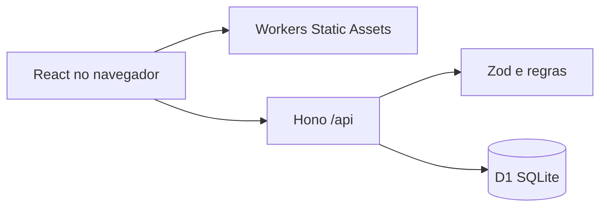

# Cupcake Store H

Versão 1.0.1: corrigidos filtros de data ao limpar campos, edição de quantidade sem zero automático, feedback com quantidade efetivamente adicionada, preço administrativo com vírgula e foco/rolagem do formulário no celular. Retestes locais: 15 unitários, 40 verificações de integração e 14 E2E aprovados. Ver [registro das correções](docs/correcoes-video-1.md).

Loja virtual acadêmica que implementa 17 histórias de usuário, do catálogo à administração de produtos, pedidos e relatórios. Pagamentos e entregas são demonstrativos, sem cobranças reais.

**Aplicação:** https://cupcake-store-h.contato-schwarz.workers.dev

**CI/CD:** [execuções reais no GitHub Actions](https://github.com/henriquefarisco/cupcake-store-h/actions/workflows/ci-cd.yml). Consulte o resultado da execução correspondente ao commit; configuração de workflow não é prova de aprovação. A credencial inicial de deploy é OAuth temporário: antes de novas publicações, veja [autenticação e renovação](docs/configuracao-github-cloudflare.md).


## Funcionalidades

- Catálogo com oito produtos ilustrados, detalhes, busca, filtros e paginação.
- Cadastro, login/logout, perfil e sessões opacas com cookies HttpOnly.
- Sacola persistente com quantidades, remoção e revisão dos valores atuais.
- Checkout com endereço brasileiro, PIX/entrega simulados, estoque transacional e idempotência.
- Confirmação e acompanhamento de pedidos do próprio cliente.
- Painel administrativo protegido no servidor para produtos, pedidos e vendas por período.

## Tecnologias e arquitetura

React, TypeScript, Vite e React Router no cliente; Hono, Zod e Web Crypto no Cloudflare Worker; SQLite pelo Cloudflare D1. GitHub Actions executa qualidade, testes, build, deploy e smoke. As migrations SQL preservam integridade, estoque e snapshots de preços. Ilustrações, logo e favicon são SVG próprios.



## Executar localmente

Requer Node.js 24 LTS e npm.

```sh
npm ci
npm run build
npm run db:local
npx wrangler dev --ip 127.0.0.1 --port 8793
```

Abra http://127.0.0.1:8793. Para desenvolvimento React com hot reload, mantenha esse Worker e execute `npm run dev`; o Vite usa proxy para a API. Não há senha administrativa fixa: cadastre uma conta e use o [procedimento de promoção](docs/manual-instalacao.md).

## Testes

```sh
npm run typecheck
npm run lint
npm run format:check
npm audit --audit-level=moderate
npm test
npm run test:integration
npx playwright install chromium
npm run test:e2e
npm run build
npm run check:private
```

Integração e E2E usam dados fictícios em workerd/D1 local. Smoke de produção é somente leitura: defina BASE_URL e execute `npm run smoke`. A execução local inicial finalizou com 11 testes unitários, 40 verificações de integração e oito testes E2E aprovados. Consulte [plano e evidências](docs/plano-testes.md) para limites e reprodução.

## Banco e publicação

`npm run db:local` aplica migrations no D1 local. `npm run db:remote` aplica no remoto autorizado. `npm run deploy` publica assets e Worker. O banco cupcake-store-h-db está vinculado no wrangler.jsonc. Nunca execute testes destrutivos no remoto. Não habilite planos pagos para resolver limites de execução.

O fluxo de main aplica migrations somente após qualidade/testes/build. Pull requests não publicam. Com o OAuth inicial, sincronize secrets pelo script local antes do push; um API token dedicado é recomendado para CI independente da estação. Consulte [implantação](docs/implantacao.md) e [configuração](docs/configuracao-github-cloudflare.md).

## Documentação

| Tema                 | Documento                                                                                                                    |
| -------------------- | ---------------------------------------------------------------------------------------------------------------------------- |
| Descoberta acadêmica | [Análise dos documentos](docs/analise-dos-documentos.md)                                                                     |
| Objetivos e escopo   | [Visão geral](docs/visao-geral.md), [requisitos](docs/requisitos.md)                                                         |
| Decisões técnicas    | [Arquitetura](docs/arquitetura.md), [diagramas renderizados](docs/diagramas/)                                                |
| Dados                | [Modelagem](docs/modelagem-banco.md), [dicionário](docs/dicionario-dados.md)                                                 |
| API                  | [Contratos HTTP](docs/api.md)                                                                                                |
| Operação             | [Manual do usuário](docs/manual-usuario.md), [instalação](docs/manual-instalacao.md)                                         |
| Qualidade            | [Plano de testes](docs/plano-testes.md), [rastreabilidade](docs/matriz-rastreabilidade.md), [laudo](docs/laudo-qualidade.md) |
| Evolução             | [Alterações](docs/registro-alteracoes.md), [riscos e limitações](docs/riscos-limitacoes.md)                                  |

Os originais acadêmicos, identificação estudantil, entregas e registros de acesso permanecem locais e excluídos do Git. Avaliações de cinco pessoas e vídeos são etapas humanas ainda pendentes; testes automatizados não os substituem.
